<picture>
  <source media="(prefers-color-scheme: dark)" srcset="assets/header-dark.svg">
  
</picture>

# Edwin Vásquez

**Full-stack software engineer, backend first.** From structural engineering to code — and from code, to quantum.

[edwinvasquez.dev](https://edwinvasquez.dev) · [LinkedIn](https://www.linkedin.com/in/edwin-gerardo-vasquez-guerrero-54124b35a) · [edgervasquez@gmail.com](mailto:edgervasquez@gmail.com) · El Salvador

I build systems that have to work every day: payments, finance, manufacturing, hospital administration. I'm comfortable across the whole cycle — I design the backend, put the database in order and leave deployment automated.

- **2 years** running systems in production
- **3 industries:** finance, manufacturing and healthcare
- **1 open-source tool** released

## Featured

### [Shorwatch](https://github.com/ErwinQuantum/shorwatch) · open source

Finds cryptography a quantum computer could break — RSA, ECDSA, Diffie-Hellman and friends — in Java, Kotlin, Spring and C#/.NET code, and points to the NIST post-quantum replacements. Reads the syntax tree (tree-sitter), not grep. Reports in SARIF, CBOM and HTML; runs as a container, a binary or a CI step.

```sh
docker run --rm -v "$PWD:/src" ghcr.io/erwinquantum/shorwatch
```

Rust · tree-sitter · Docker · GitHub Actions

### ERP for construction companies · private

Projects, works, crews, assignments and permits for builders — and the part I care most about: reading quantities and materials straight from Revit models. 5 services, 12 containers, 700+ tests. [Watch the 23-second walkthrough →](https://edwinvasquez.dev/en/trayectoria/obras)

Java · Spring Boot · Spring Cloud · Python · FastAPI · PostgreSQL · Redis · Next.js · Docker · Prometheus · Grafana

## This year, under construction

<picture>
  <source media="(prefers-color-scheme: dark)" srcset="https://raw.githubusercontent.com/ErwinQuantum/ErwinQuantum/output/city-dark.svg">
  
</picture>

<sub>Redrawn every day by a GitHub Action in this repo (<code>city/build.py</code>), private work included as counts only.</sub>

## What I work with

- **Backend & data** — Java, Spring, C#/.NET, Python (FastAPI, Django), Node, PostgreSQL, MySQL, MongoDB, Redis, SQL Server
- **Delivery & cloud** — Docker, Kubernetes, Terraform, NGINX, GitHub Actions, Azure DevOps, AWS, Azure, Grafana, SonarQube
- **Frontend** — React, Next.js, Angular, React Native, Vue, Tailwind
- **Quantum** — Q#, Qiskit

## Now

- Preparing **AZ-104** (Azure Administrator).
- Writing quantum programs in **Q#** and **Qiskit**, on the way to a master's in quantum computing.
- Studying Software Development Engineering after three years of Civil Engineering — the engineer in me still checks the loads.

Off the keyboard: Dostoevsky first, then Camus, Poe, Conan Doyle, Cervantes and dystopias.

<details>
<summary><b>En español</b></summary>

<br>

**Ingeniero de software full-stack, con el backend primero.** Del cálculo estructural al código; del código, a lo cuántico.

Construyo sistemas que tienen que funcionar todos los días: cobros, finanzas, manufactura, administración hospitalaria. Me muevo cómodo en todo el ciclo: diseño el backend, ordeno la base de datos y dejo el despliegue automatizado.

- **2 años** con sistemas en producción · **3 sectores**: finanzas, manufactura y salud · **1 herramienta open source** publicada.
- **[Shorwatch](https://github.com/ErwinQuantum/shorwatch):** detecta en el código la criptografía que una computadora cuántica podría romper y propone cómo migrar a los estándares post-cuánticos del NIST.
- **ERP para constructoras** (privado): proyectos, obras, personal, asignaciones y permisos, con integración con Revit. [Míralo en video →](https://edwinvasquez.dev/es/trayectoria/obras)
- **Ahora:** preparando AZ-104, programando con Q# y Qiskit, y con la mira en una maestría en computación cuántica.

Todo, con más detalle, en **[edwinvasquez.dev](https://edwinvasquez.dev)**.

</details>
